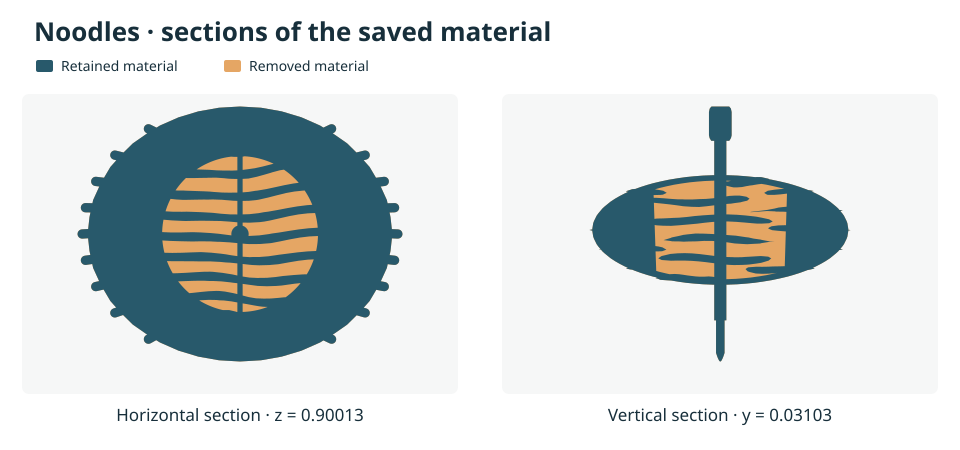

# M36 · 固定壳层上的减重界与 PINO 原生试探

所有 Noodles 实验沿用 M32 的单密度材料、原始外形、陀尖、指定轴与允许挖空的 D′。几何优化和 Newton 试验是两项独立实验。下表的百分比以同一原始完整实体为分母。单密度下，减重比例等于材料体积降幅。

## 无质心升高的数字设计

| 构造 | 减重 | 原固定轴惯量保留 | 平衡和高度 |
|---|---:|---:|---|
| 单一光滑锥面在 D′ 内划出的空腔 | 26.51064%–26.51439% | 90.01356%–90.01644% | 横向质心 L1 偏移 ≤0.000083 模型单位，主轴夹角正弦 ≤0.000170，质心严格下降 |
| 256 边内接锥台，外加八个校正盒 | 26.510709% | 90.016358% | 四项平衡矩严格为零，质心下降 0.00020005 模型单位 |
| 圆柱内接多面体与八个校正盒 | 26.523483% | 90.011354% | 四项平衡矩严格为零，质心升高 0.00110137 模型单位 |

在允许任意挖除 D′ 子集的松弛问题中，非负惯量乘子和四个平衡矩的乘子给出减重上界 26.5387294%。锥台校正构造同时满足质心不升条件，故再加上这项条件后的最优减重与该构造相差至多 0.0280201 个百分点。此界限于该模型、固定的设计域和矩约束；加入拓扑、工艺厚度或打印条件后，构造是否可行需要另行验证。

导出的整件几何使用各校正盒体积区间的有理中点。W0 重新读取文件，独立积分全部三角面，四项平衡矩最大绝对残差小于 2.87e-15。这个有限有理坐标文件与符号精确平衡的构造可分别重建。文件有 56,793 个顶点、114,214 个三角面，原始唯一陀尖保留。精确 M26 谓词检查了全部 1,329,501 对候选三角形，其中 251,937 对没有公共顶点，全部通过。M26 同时逐边和逐顶点检查定向闭二流形条件。

材料连成一件。10 个边界分量包括外表面、亏格 167 的主腔表面和八个盒腔表面，因此整件未满足数学意义上的单连通。八个盒腔的高度约 0.00334–0.00563 毫米，实际打印保真度和旋转稳定性尚待测量。

[W4 构造、上界和求值代码](https://github.com/volcano-code/Spin_test2/blob/d275b35931bb49d58301254ff27e84fd13fb593e/research/Noodles_M32/M36_QUADRIC_MASS.md)

## PINO 导数进入原生求解器

最初的挖腔起点虽保留 99.97856% 惯量，但原生初始乘子 −12.36，求解器按既有判据退出。第二起点根据设计域顶点的椭球度量第 97.5 百分位生成，保留 98.23135% 惯量，原生乘子 12.0651。

同一第二起点的三组试验均提供精确锚点十矩。原生 C++ 球面 Newton 从相应 Jacobian 生成试探方向；每个候选均在原离散曲面上用 libigl/CGAL 重新切割整份精确 D′，以带符号十矩区间核验 90% 惯量，合格后用精确移动面导数完成原生接受判定。几何输出、导数和接受事件按查询逐一绑定。学习组取预先固定的解析训练种子 131，使用 24³ 个节点和 0.0075 温度。数值对照使用同一批节点和温度，所有节点的非负门权均设为 1。

| 锚点导数 | 首次试探惯量 | 首次接受所需真实试探 | 首次接受后减重 | 首次接受后方程残差 |
|---|---:|---:|---:|---:|
| 精确离散导数 | 94.2479% | 1 | 13.2108% | 0.206039 |
| PINO 导数 | 86.7221% | 2，原生半步回退 | 1.3579% | 2.577003 |
| 同节点数值导数 | 87.0342% | 2，原生半步回退 | 1.2650% | 2.580356 |

封存的一次试探对照中，两种近似导数都未通过惯量门槛。随后分别复用原拒绝记录，让原生线搜索将提议步长减半；PINO 候选保留惯量 99.1712%，数值候选保留 99.3026%，原生程序均明确接受。这些计数只含锚点之后的精确试探，不计共同的锚点十矩或训练。没有测量同精度的完整求解加速。

精确导数继续执行第二次更新，第三次查询因惯量 89.7635% 被拒，第四次查询获准，终点减重 16.3415%、保留惯量 92.0483%、方程残差 0.0854644、物理相对残差 0.0022452。诊断达到两步预算上限。上述中间点不计入独立验收的质量优化成绩。

## 跨几何切割与误差

W1 用此前未对 W6 开放标签的 Bunny 建立测试，原网格经过精确闭合、定向和自交检查，无需修补。三种切割涵盖 600 个有限差分分量，最大缩放差为 2.69e-8。Bunny 是独立的算子几何测试，不带 Noodles 的旋转任务身份。

在 Noodles 初始小切块上，学习头将节点从 6³ 增至 24³ 并调整温度后，十矩相对 L2 降至 0.617，原值为 70.198；Jacobian 误差从 0.599 升至 0.768。在 Bunny 三个切割上，椭球局部求积及回退方案的平均十矩／Jacobian 相对误差分别为 0.393／0.359，匹配的纯数值对照为 0.079／0.091。真实标签仅作评分。两种几何还不足以估计跨模型成功率。

[W1 独立几何与标签](https://github.com/volcano-code/Spin_test2/blob/9af2f237d51b47d9b87d57fbb5aaf68ea5042045/research/NeuralMoments/performance/M36_BUNNY_DISCRETE_HOLDOUT.md) · [W6 实验、逐样本结果与数值对照](https://github.com/volcano-code/Spin_test2/blob/22a0d69094062b6bb3a6078c4a548fff4ae891d6/research/NeuralMoments/models/pcraft_ufno/spin_pino/M36_REFINEMENT.md)

## 重放入口与原始材料

W0 的 `m35_crossing_newton` 新增 `--enforce-inertia90 A.ten`。调用 `m36_one_step --help` 可查看同起点第一次试探与拒绝后半步回退的参数。`m36_export_model` 使用 W4 的 `cone-assembled.json`、质量证书以及 M32 原始十矩，生成最终有理网格和整件积分回执。`m36_sections` 从原始和保存后的三角面提取闭合剖面。`m36_shard_embedding` 按外层面编号分配相交候选，每个分片保留完整空间索引，通过后才合并计数。

原始材料包 `Spin_test2_M36_geometry_and_trials.tar.zst` 的 SHA-256 为 `f023a3ea5f26a0ad7be22fd42da9ae411381365a05af11d7d02e5a9565fa7663`，内含逐文件摘要、Noodles 主模型、锥面及圆柱两侧包络、Bunny 差分样本，以及学习与数值试探结果。保存的整模位于 `Noodles/final/retained_cone_with_eight_cavities.json`；有理坐标以字符串保存。Linux 可用 `tar --zstd -xf Spin_test2_M36_geometry_and_trials.tar.zst` 解包。
